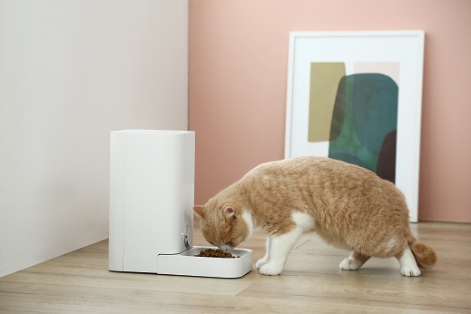
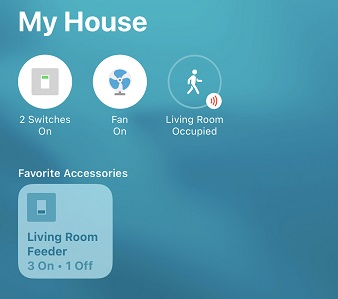
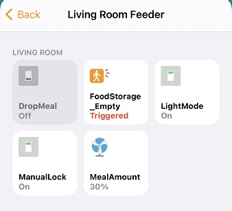
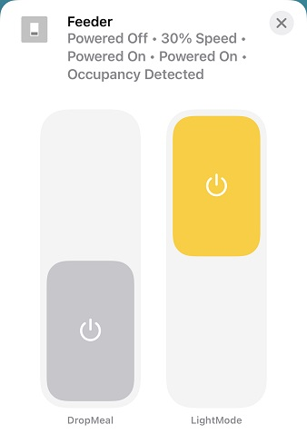
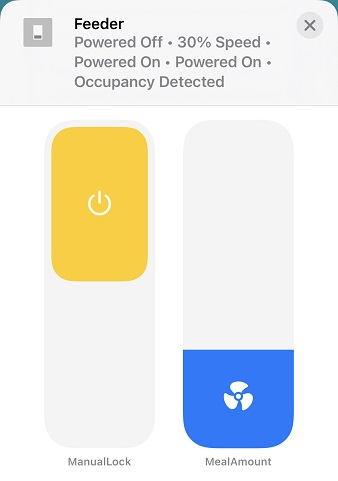
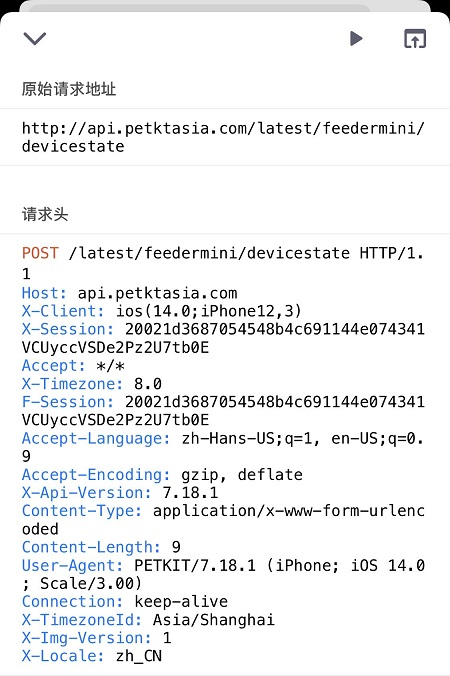

## homebridge-petkit-feeder-mini

<p align="center">
  
  <br>
  <a href="https://www.npmjs.com/package/homebridge-petkit-feeder-mini">
    
  </a>
  <a href="https://www.npmjs.com/package/homebridge-petkit-feeder-mini">
    
  </a>
  <a href="https://github.com/homebridge/homebridge/wiki/Verified-Plugins">
    
  </a>
  <br>
  <strong><a href="#2-how-to-setup">Setup Guide</a> | <a href="#4-how-to-contribute">Contribute</a> </strong>
</p>


## 0）Important Note！

<strong>v3.0.0 is a breaking change, please read this section carefully before upgrading!</strong>

- the configuration file format of v3.0.0 is <strong>NOT compatible</strong> with any previous version (the <code>devices</code> array, <code>model</code>, <code>deviceId</code>, <code>group_id</code> and the captured <code>headers</code> are all gone, and <code>location</code> is replaced by the <code>region</code> country code, the server address is derived from the region automatically), please <strong>remove the old config and re-configure this plugin</strong> from the settings page after upgrading;
- since v3.0.0, this plugin uses a brand new <strong>account + password login</strong> to talk to the Petkit server, the packet capture based <code>X-Session</code> login is no longer needed;
- the account filled in this plugin <strong>must have the permission of all the devices you want to control</strong> (owned by the account, or shared to it);
- Petkit only allows <strong>one active session per account</strong>, which means this plugin <strong>can NOT stay logged in at the same time as the Petkit App</strong> when using the same account, logging in on one side will kick the other side out;
- therefore, it is highly recommended to <strong>create a dedicated Petkit account</strong>, let the device owner <strong>share the devices to that account</strong> from the main app, and then fill in the dedicated account's username and password in this plugin.

<strong>v3.0.0 为破坏性更新，升级前请务必仔细阅读本节！</strong>

- v3.0.0 的配置文件格式与之前所有版本<strong>不兼容</strong>（<code>devices</code> 数组、<code>model</code>、<code>deviceId</code>、<code>group_id</code> 以及抓包获得的 <code>headers</code> 配置均已移除，<code>location</code> 已替换为 <code>region</code> 国家代码，服务器地址由国家代码自动确定），升级后请<strong>删除旧配置，并在设置页面中重新配置本插件</strong>；
- 自 v3.0.0 起，本插件采用全新的<strong>账号 + 密码登录</strong>方式与 Petkit 服务器通信，不再需要抓包获取 <code>X-Session</code>；
- 在本插件中填写的账号，<strong>必须拥有所有需要被控制的设备的权限</strong>（设备属于该账号，或已分享给该账号）；
- Petkit 每个账号同时只允许<strong>一个活跃会话</strong>，因此使用同一账号时，本插件<strong>无法与 Petkit App 同时保持登录</strong>，一方登录会将另一方踢下线；
- 因此强烈建议<strong>单独注册一个专用账号</strong>，由设备所有者在主账号 App 中将设备<strong>分享给该专用账号</strong>，再在本插件中填入该专用账号的用户名和密码进行控制。


## 1) Description

control your petkit feeder mini from homekit, get full use of iOS automation.

<p align="center">
  
  <br>
  
</p>


### features

- provides a custom settings page in the Homebridge UI: test login with your Petkit account, pick which devices to control, no packet capture needed(since v3.0.0);
- uses a fan speed to control the meal amount;
- uses a switch to commit the drop;
- uses a switch to control the Petkit feeder mini light mode;
- uses a switch to control the Petkit feeder mini manual lock;
- uses a occupancy to indicate food storage status;
- uses a filter maintenance to indicate desiccant status(include auto reset desiccant left days, this may not show in homekit);
- uses a battery service to indicate device power status(only for Petkit Feeder Mini, include power level, charging status and low battery alert in Homekit)
- can fetch device info from Petkit server and shows in Homekit.


### limitations

- enable/disable meal plan for the day(may be in the next major version, currently no plan to do it).
- currently this plugin for <a href="https://github.com/homebridge/homebridge">homebridge</a> just tested with <a href="https://petkit.co.uk/product/petkit-element-mini-auto-feeder/">Petkit-feeder-mini (official store link)</a>, and this plugin currently only tested and works in Asia(include China mainland) and North America, other area may need more work.
- (since v3.0.0) with account login mode, this plugin logs into the Petkit server for you, discovers <strong>all the devices of your account</strong> automatically, fetches the X-Session and group id automatically, persists the session id to disk and re-login automatically when the session expires. Note that Petkit only allows one active session per account, so a dedicated Petkit account is recommended.
- because version 3.x.x is developed on a dynamic platform plugin, and not implement auto remove deleted device(s), so you may need to delete cached accessories manually.
- <strong>service names</strong>: every device is exported as one HomeKit accessory named after the device(智能喂食器 etc.), with one sub-accessory per service(DropMeal switch, MealAmount fan, FoodStorage indicator, Desiccant filter, ManualLock switch, LightMode switch, Battery). The sub-accessory names come from the <code>*_name</code> config items, and the plugin re-applies them on every homebridge restart, even for accessories cached by an older plugin version. Note that the Home app on iOS may keep showing previously cached names for already-paired accessories: if a sub-accessory still shows the old name(like the accessory name) after a restart, rename it once in the Home app, or re-pair the bridge to pick up the configured names.
- ......


## 2) How to setup

### Firstly, setup your Petkit mobile app.

Goto App Store, download Petkit mobile app, register, login, add device. before use this plugin you <strong>MUST</strong> make sure the app works fine with you.

- for China mainland users, download “小佩宠物”
- for those Asia users outside China mainland, you should download "PetKit(International)"
- for users not from Asia, like America, Europe, etc. you also should download "PetKit(International)", but the API url address may not the same, this plugin may or may not works with you, if you are experienced in network, you could use "Quantumult X" to capture app network records, submit the api address to me or just create a PR or just modify this plugin for your own.


### Secondly, configure the plugin in the Homebridge settings page.

Since v3.0.0, this plugin provides a <strong>custom settings page</strong> in the Homebridge UI. Open the plugin settings and you will see:

1. <strong>账号登录 (Account login)</strong>: choose the <strong>country / region</strong> (<code>region</code>, a dropdown of all the country codes, the <strong>server address</strong> of this country code is used automatically), then fill in the account (<code>username</code> / <code>password</code>) and click the <strong>测试登录 (Test Login)</strong> button. This plugin logs into the Petkit server exactly like the Petkit app does (the password is sent md5-hashed, same as the official app). Login errors are shown in the page with the reason returned by the server. The timezone is taken from the server reply automatically, no timezone setting is needed.
2. <strong>选择要控制的设备 (Device selection)</strong>: only shown after a successful login, this plugin fetches <strong>all the devices of your account</strong> (owned and shared) from the server, and you can choose which devices to control. Unchecked devices are not added to HomeKit. You can also give each selected device a custom display name, so you can easily tell which device is which in HomeKit.
3. <strong>其他设置 (Other settings)</strong>: polling, service names and other options, enabled only after a successful login.

After saving the config, this plugin will:

- fetch the <strong>X-Session</strong> and the <strong>group_id</strong> from the server automatically, no packet capture needed;
- persist the session id to disk, so it is reused after homebridge restarts instead of logging in every time;
- re-login automatically when the server replies that the session is expired.

If login fails with an account/region error, set <code>region</code> to the country code of your Petkit account (e.g. CN / HK / JP / SG / US / CA / IT). The timezone is taken from the server reply automatically, no timezone setting is needed.

> Petkit only allows one active session per account: use a dedicated account and share the device with it from the main app, otherwise every time you open the app this plugin will be logged out (and vice versa).

#### Captured headers (legacy)

If you don't want to provide your account password, you can still capture the http request headers of the Petkit app as before, and put them in the <code>headers</code> field of the config.json directly. Please goto <a href="https://github.com/elfive/homebridge-petkit-feeder-mini/wiki#how-to-capture-http-netflow">this</a> wiki page to find more detail.

### Finally, retrieve infomation.

No information needs to be retrieved by hand any more: with account login, the plugin obtains X-Session and group_id by itself; with captured headers mode, you only need to provide the **X-Session** in the platform config headers.

Be aware of that, to minimize the effect to the Petkit server with unnecessary http requests, the plugin just update device status more than 10s interval, which means the status will bufferd at lease 10s. 

- X-Session: this value will change every time you login you Petkit app, so do not logoff your Petkit app unless necessary. 

here is a example of Quantumult X capture data page:

<p align="center"></p>
you can find X-Session data from the request header area and deviceId in response data area.


## 3) Configure

### config.json field

All the settings below are <strong>platform level</strong> settings: this plugin reads every device of your account from the Petkit server and adds an accessory for each of the devices selected in the settings page, no <code>deviceId</code>, no <code>group_id</code> needed.

|           field   name            |  type  | required |                  default                   |                range                | description                                                  |
| :-------------------------------: | :----: | :------: | :----------------------------------------: | :---------------------------------: | ------------------------------------------------------------ |
|             platform              | string |   yes    |            'petkit_feeder_mini'             |        'petkit_feeder_mini'         | Must be 'petkit_feeder_mini' in order to use this plugin.    |
|             log_level             |  int   |    no    |                      2                      |            1,2,3,4,9                | one of these values:<br/>- 1: Debug<br/>- 2: Info<br/>- 3: Warn<br/>- 4: Error<br/>- 9: None |
|              region               | string |    no    |                     'CN'                    |                 ---                 | the country code of your Petkit account, sent to the login request. The Petkit server address is taken from the official server of this country code automatically. If login fails, set it to your own country code, e.g. CN / HK / JP / SG / US / CA / IT ... |
|              username             | string |    no    |                    ---                     |                 ---                 | your Petkit account username/email. Provide username and password together to enable account login mode, then the <strong>headers below are no longer needed</strong>. All the devices of this account will be added automatically. |
|              password             | string |    no    |                    ---                     |                 ---                 | your Petkit account password. Only used to login the Petkit server, never persisted to disk. |
|              devices              | array  |    no    |                    ---                     |                 ---                 | the devices this plugin should control, selected in the custom settings page after a successful login. Each entry is either a device id string, or an object like <code>{"id": "123", "name": "Living Room Feeder"}</code> to give the device a custom display name in HomeKit. An empty array means no device is controlled, omit this field to control all devices of the account. |
|              headers              | array  |    no    |                    ---                     |                 ---                 | http request headers, only needed in captured headers(legacy) mode.<br/>See more detail info at <a href="#headers field">headers field</a> below. |
|           DropMeal_name           | string |    no    |                 'DropMeal'                 |                 ---                 | name of DropMeal switch in HomeKit, shared by every device.  |
|          MealAmount_name          | string |    no    |                'MealAmount'                |                 ---                 | name of MealAmount fan speed in HomeKit, shared by every device. |
|         FoodStorage_name          | string |    no    | 'FoodStorage_Empty'<br>or<br>'FoodStorage' |                 ---                 | name of FoodStorage indicator in HomeKit.<br>Note: if reverse_foodStorage_indicator value is set to true, then the default name is 'FoodStorage_Empty', otherwise 'FoodStorage' |
|        DesiccantLevel_name        | string |    no    |              'DesiccantLevel'              |                 ---                 | name of DesiccantLevel indicator in HomeKit.                 |
|          ManualLock_name          | string |    no    |                'ManualLock'                |                 ---                 | name of ManualLock switch in HomeKit.                        |
|          LightMode_name           | string |    no    |                'LightMode'                 |                 ---                 | name of LightMode switch in HomeKit.                         |
|           Battery_name            | string |    no    |                 'Battery'                  |                 ---                 | name of Battery indicator in HomeKit.                        |
|         polling_interval          |  int   |    no    |                     60                     |             60 to 3600              | update device info interval from Petkit server(s). device status polling is always enabled. |
|         enable_manualLock         |  bool  |    no    |                   false                    |             true/false              | if enabled, a switch will show in homekit to control the manual lock of the feeder. |
|         enable_lightMode          |  bool  |    no    |                   false                    |             true/false              | if enabled, a switch will show in homekit to control the lighe mode of the feeder. |
| reverse_foodStorage<br>_indicator |  bool  |    no    |                   false                    |             true/false              | normally, the occupancy will show an alert in homekit when there is enough food in the feeder, in which situation may not so recognizable, so you can reverse the status bu set this value to true, so when there is not much food, it can show an alert in homekit. |
| ignore_battery_when<br/>_charging |  bool  |    no    |                   false                    |             true/false              | Ignore battery low level alerm when device connected to a power source.<br>And battery function is disabled when using a Petkit Feeder Element device. |
|           fast_response           |  bool  |    no    |                   false                    |             true/false              | if set to true, then when received a Homekit set request, return immediately, ignore the result.<br>this is useful when your homebridge or Petkit device has a bad internet connection. |


### headers field (only for captured headers mode)

| field   name  |  type  | required | default  |   range   | description                                                                                                                                                                                                       |
| :-----------: | :----: | :------: | :------: | :-------: | ----------------------------------------------------------------------------------------------------------------------------------------------------------------------------------------------------------------- |
|   X-Session   | string |   yes    |   ---    |    ---    | Tell server who you are. This changes everytime you login Petkit app. In account login mode, this plugin fetches this value automatically, you don't need to provide it.                                          |
| X-Api-Version | string |  prefer  | '7.18.1' |    ---    | For China mainland users, this field is not necessary, but for users outside China mainland, this field is optional, if not provided, then the default value will be used. but we recommand to fufill this field. |
|  X-Timezone   |  int   |    no    |    8     | -12 to 12 | Your local timezone offset, UTC time. If autoDeviceInfo is set to true, it will overwrited with the timezone of your device, which is set in your Petkit app.                                                     |

we recomand you entered all the headers you captured. If you don't want to do so, please ensure header "X-Session" is correctly entered.


### example of config.json file (account login mode, recommended)

```json
"platforms": [{
  "log_level": 2,
  "region": "CN",
  "username": "your_petkit_account@example.com",
  "password": "your_petkit_account_password",
  "devices": [{"id": "123456789", "name": "Living Room Feeder"}, "987654321"],
  "DropMeal_name": "DropMeal",
  "MealAmount_name": "MealAmount",
  "FoodStorage_name": "FoodStorage",
  "DesiccantLevel_name": "DesiccantLevel",
  "ManualLock_name": "ManualLock",
  "LightMode_name": "LightMode",
  "Battery_name": "Battery",
  "polling_interval": 60,
  "enable_desiccant": true,
  "alert_desiccant_threshold": 7,
  "enable_autoreset_desiccant": true,
  "reset_desiccant_threshold": 5,
  "enable_manualLock": true,
  "enable_lightMode": true,
  "reverse_foodStorage_indicator": true,
  "fast_response": true,
  "platform": "petkit_feeder_mini"
}]
```

### example of config.json file (captured headers mode, legacy)

```json
"platforms": [{
  "log_level": 2,
  "region": "CN",
  "headers": [
    {
      "key": "X-Session",
      "value": "xxxxxx"
    }
  ],
  "DropMeal_name": "DropMeal",
  "MealAmount_name": "MealAmount",
  "FoodStorage_name": "FoodStorage",
  "DesiccantLevel_name": "DesiccantLevel",
  "ManualLock_name": "ManualLock",
  "LightMode_name": "LightMode",
  "Battery_name": "Battery",
  "polling_interval": 60,
  "enable_desiccant": true,
  "alert_desiccant_threshold": 7,
  "enable_autoreset_desiccant": true,
  "reset_desiccant_threshold": 5,
  "enable_manualLock": true,
  "enable_lightMode": true,
  "reverse_foodStorage_indicator": true,
  "fast_response": true,
  "platform": "petkit_feeder_mini"
}]
```

### session persistence

In account login mode, the session id is cached in `<homebridge_storage_path>/homebridge-petkit-feeder-mini/petkit-session.json` and reused across homebridge restarts. Only the session id and its login time are stored, <strong>your password is never persisted</strong>. If the cached session is expired or invalid, this plugin re-login with your account automatically.


